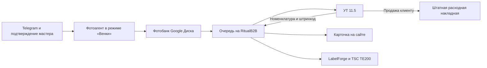

# Венки RitualB2B от фотографии до карточки и этикетки

## Первый запуск

Работаем с «1С:Управление торговлей» 11.5.26.106 на платформе 8.5.1.1302. Доступ к программе сейчас через RDP. На первом этапе автоматизируем создание номенклатуры, фото, размеры, штрихкод, публикацию и подготовку этикетки. Оприходование, состав материалов и расчёт себестоимости относятся к следующему этапу. [Релиз Управления торговлей](https://torg.1c.ru/news/novoe-v-1s-upravlenii-torgovley-red-11-versiya-11-5-26-106/).

1. Мастер отправляет снимок в Telegram. Бот предлагает пять вариантов названия, принимает своё название и собирает габариты в сантиметрах, продажную цену и, при необходимости, форму венка. Для модели, которая уже заведена, можно выбрать существующую позицию в 1С или карточку сайта.
2. Фотоагент обрабатывает снимок в режиме `wreath`. На эталонном фоне остаются реальный венок, название и размер. Бот показывает результат с отдельными полями цены и метки «Новинка» или «Регулярный ассортимент». Мастер подтверждает готовый вариант.
3. Оригинал и готовый снимок уходят в закрытую папку фотобанка на Google Диске. В УТ создаётся или дополняется номенклатура. Коннектор возвращает идентификатор позиции, артикул и штрихкод. Сайт публикует карточку с утверждённой ценой. Новая карточка получает статус «Под заказ».
4. Бот получает ссылку на опубликованную карточку и данные для этикетки. LabelForge на офисном компьютере готовит макет 70 × 120 мм с названием, размером, артикулом и штрихкодом.



## Что реализовано в проекте

- Сайт принимает утверждённую карточку с готовым фото и хранит её в SQLite до ответа УТ. После подтверждения публикует через действующий каталог и возвращает ссылку с данными для печати. Связь с УТ сохраняется по идентификатору номенклатуры. Повтор той же заявки или того же ответа возвращает уже записанный результат. Для существующей карточки указываем её SKU и сохраняем связь с прежней страницей. [API сайта](../api/product-release.php), [Обработка заявки](../lib/product_release.php).
- Подготовлен редактируемый шаблон LabelForge 70 × 120 мм. Скрипт формирует файл печати из результата сайта и по явной команде может отправить его на `TSC TE200`. Устройство зарегистрировано в Windows через USB. В шаблоне пробный зазор 3 мм по существующему профилю LabelForge. Значение уточняется на рулоне при первом физическом тесте. [Шаблон](../tools/labels/wreath_70x120.json), [Подготовка печати](../tools/print-wreath-label.ps1), [Технические характеристики TE200](https://apac.tscprinters.com/en/product-comparison?skus=TE200).

Для проверки файла этикетки из сохранённого ответа `status` используется Windows PowerShell.

```powershell
powershell.exe -NoProfile -ExecutionPolicy RemoteSigned -File tools/print-wreath-label.ps1 -JobPath job.json -ExportPath wreath.prn
```

Для передачи задания принтеру служит параметр `-Print`. Результат означает передачу в очередь Windows. На пилоте проверяем размер, положение на наклейке и чтение кода сканером.

## Интерфейс обмена для подключения к УТ

Все операции отправляются как `POST` на `/api/product-release.php?action=...`. Тело в JSON. Для бота нужен Bearer-ключ `RITUAL_RELEASE_PRODUCER_KEY`, для УТ — `RITUAL_RELEASE_1C_KEY`. Значения настраиваются в окружении сервера.

| Операция | Тело и результат |
| --- | --- |
| `enqueue` | `release_id` в формате UUID, `name`, `height_cm`, `width_cm`, `price_rub`, `photo_base64`. Дополнительно `shape`, `label`, `label_copies`, `onec_id` и `site_sku`, если привязываем существующие записи. Фото в JPEG, PNG или WebP до 6 МиБ. Возвращает `waiting_1c`. |
| `next` | `{}`. УТ получает старейшую необработанную заявку или `job: null`. |
| `confirm` | `release_id`, `onec_id` в формате UUID, `article`, `barcode` и `barcode_type`. Поддерживаем валидный `ean13` и простой внутренний `code128` до 18 символов. Возвращает `published`, ссылку `catalog_path` и объект `label`. |
| `status` | `release_id`. Возвращает сохранённый статус и, когда карточка опубликована, её ссылку и данные этикетки. |

Обмен запускает задание в тестовой УТ или процесс рядом с базой. Оно забирает заявки исходящим HTTPS. До создания объекта проверяет `release_id` в своём журнале, после записи сохраняет соответствие с номенклатурой. При обрыве связи отправляет прежнее подтверждение. В тестовой копии проверяем вид номенклатуры, единицу измерения, назначение размеров, прикрепление изображения, правило выдачи артикула и допустимый тип штрихкода. [Интеграция платформы 1С](https://v8.1c.ru/platforma/integraciya/).

## Подключения для рабочего запуска

1. **Тестовая УТ.** Подключить обмен и провести один контрольный венок от заявки до реальной записи в справочнике. Сравнить данные в УТ, карточке и на распечатанной наклейке. Отдельно проверить дополнение уже созданной номенклатуры и повтор после обрыва связи.
2. **Telegram, фотоагент и Google Диск.** Реализовать диалог бота и связать его с очередью существующего фотоагента через `submit-job`, `mode=wreath` и стабильный `request_key`. Подтвердить получение результата и архивирование до вызова `enqueue`. На момент проверки Telegram сообщал, что рабочий процесс фотоагента не отвечает. Для живого прогона нужен работающий обработчик очереди. [API Telegram](https://core.telegram.org/bots/api), [Загрузка файлов Google Drive](https://developers.google.com/workspace/drive/api/guides/manage-uploads).
3. **Офисная печать.** После контрольной наклейки подключить локальную очередь с учётом номера задания. Если отправка прервалась, сначала сверять состояние задания Windows и только затем повторять.
4. **Расходная накладная.** Привязать штатную печатную форму к продаже клиенту. В типовой УТ продажа оформляется документом «Реализация товаров и услуг». Точное название формы и точку запуска сверяем по экрану из вашей базы. [Продажи в Управлении торговлей](https://v8.1c.ru/trade/upravlenie-prodazhami/).
5. **Остатки и себестоимость.** После настройки учёта материалов проверить документ «Сборка товаров» или действующий способ оприходования, выбранный с ответственным за УТ. После начала складского учёта передавать подтверждённые остатки на сайт. Расчёт затрат опирается на фактически использованные материалы и работу мастера. [Управление складом и запасами в УТ](https://v8.1c.ru/trade/upravlenie-skladom-i-zapasami/).
